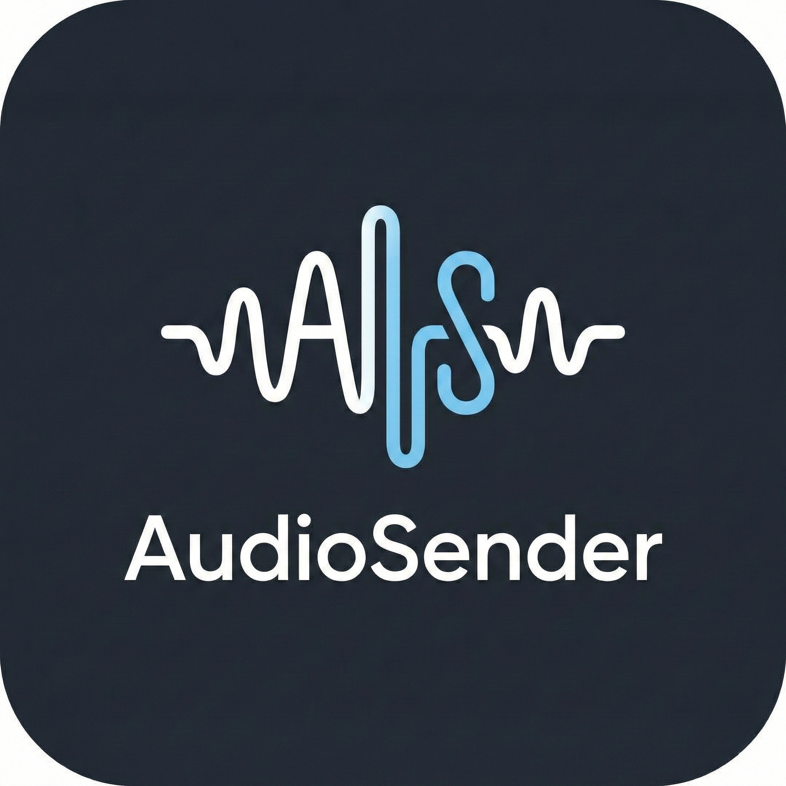

<p align="center">
  
</p>

<h1 align="center">🔊 AudioSender</h1>

<p align="center">
  <strong>Ultra-low latency audio streaming between Windows computers.</strong>
</p>

<p align="center">
  
  
  
</p>

---

AudioSender is a lightweight, high-performance audio relay application designed for streaming PC audio to another PC over a local network with minimal latency. Built with **Rust** and powered by **WASAPI**, it provides a seamless computer-to-computer audio experience.

## 📋 Table of Contents

- [🚀 Key Features](#-key-features)
- [🛠️ Requirements](#️-requirements)
- [💻 Quick Start](#-quick-start)
- [⚙️ Configuration](#️-configuration)
- [🔍 How It Works](#-how-it-works)
- [⚖️ License](#️-license)

---

## 🚀 Key Features

*   **⚡ Ultra-Low Latency:** Optimized for real-time audio with minimal delay (default 5ms buffer).
*   **📡 Auto-Discovery:** Clients automatically find servers on the local network using UDP broadcast.
*   **🔊 WASAPI Integration:** Uses Windows Audio Session API for high-quality loopback capture.
*   **🎧 Opus Codec:** Studio-quality audio compression (128 kbps) with low overhead.
*   **🖥️ Modern GUI:** Easy-to-use interface with system tray integration and auto-start options.
*   **🛡️ Stable Streaming:** UDP-based protocol prioritizing real-time delivery.

---

## 🛠️ Requirements

*   **OS:** Windows 10 or newer.
*   **Network:** Both computers must be on the same local network for auto-discovery.
*   **Firewall:** Allow UDP ports **59100** (discovery) and **59200** (streaming).

---

## 💻 Usage

### 🎨 GUI Mode
Simply run `audio_sender.exe`. This is the default mode and provides a full dashboard for configuration and monitoring.

### ⌨️ CLI Mode
AudioSender also supports a full command-line interface for headless environments or scripting:

**Server (Source):**
```bash
# Start with default settings
audio_sender.exe server

# List available audio devices
audio_sender.exe list-devices

# Start with a specific audio device
audio_sender.exe server --device "Stereo Mix (Realtek)"
```

**Client (Receiver):**
```bash
# Auto-discover server
audio_sender.exe client

# Connect directly to an IP
audio_sender.exe client --connect 192.168.1.50
```

---

## ⚙️ Configuration

Settings are stored in `%APPDATA%\AudioSender\config.toml`. You can also adjust these via the **⚙ Settings** menu in the GUI:

*   **Server Name:** How your PC appears on the network.
*   **Buffer Size:** Adjust latency vs. stability (1ms to 50ms).
*   **Bitrate:** Control audio quality (64 kbps to 320 kbps).
*   **Auto-Start:** Option to start with Windows or minimize to tray.

---

## 🔍 How It Works

1.  **Capture:** The server uses WASAPI loopback to capture high-fidelity system audio.
2.  **Encode:** Audio data is compressed using the **Opus** codec (LOW_DELAY mode).
3.  **Transport:** Encoded packets are sent via **UDP** to eliminate TCP retransmission delays.
4.  **Playback:** The client receives, decodes, and plays the audio with minimal jitter buffering.

---

## ⚖️ License

Distributed under the **MIT License**. See `LICENSE` for more information.

---

<p align="center">
  Built with ❤️ using <a href="https://www.rust-lang.org/">Rust</a>
</p>
